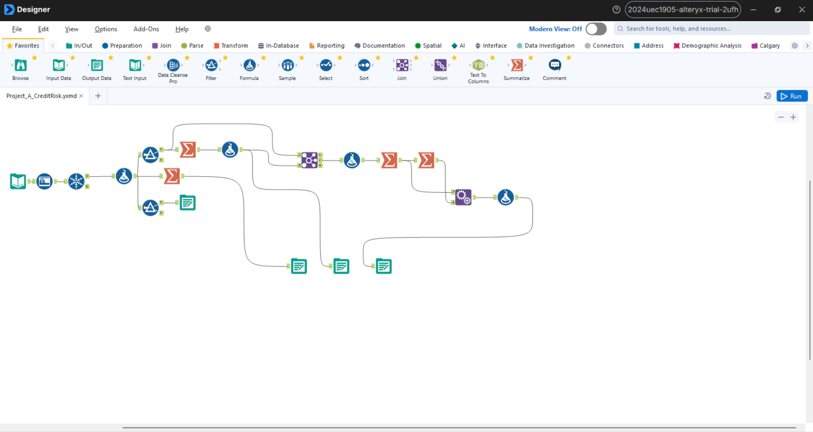
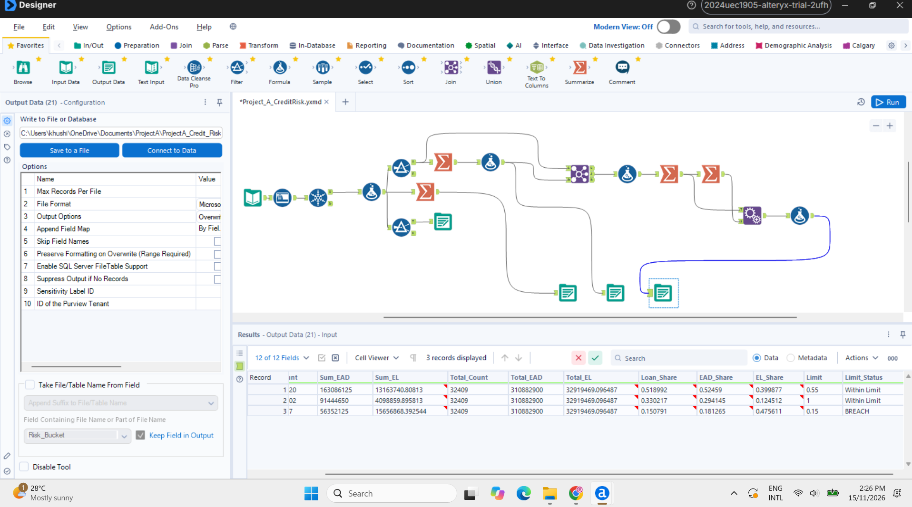

# Credit Risk Exposure & Limit Monitoring (Alteryx)

An end-to-end credit risk workflow built in **Alteryx Designer** on **32,581 consumer loans**. It checks data quality, estimates **Expected Loss (PD × LGD × EAD)**, groups loans into risk buckets, and flags **risk-limit breaches**, similar to the daily work of a Credit Risk Middle Office team.

---

## Business questions

1. **Can the loan data be trusted?** → Data quality checks
2. **How much could the bank lose if borrowers don't repay?** → Expected Loss model
3. **Is the bank taking more risk than its limits allow?** → Limit monitoring

---

## Key results

| Metric | Result |
|---|---|
| Loans analysed | 32,581 |
| Data-quality exceptions flagged | **4,086** (165 duplicates, 7 critical, 3,914 warnings) |
| Clean loans used for risk calculation | 32,409 |
| Total exposure (EAD) | 310.9M |
| Total expected loss | **32.9M** (10.6% of exposure) |
| High-risk share of loans | **15.1%** |
| High-risk share of expected loss | **47.6%** |
| Limit check | **BREACH**: high-risk exposure 18.1% vs 15% limit |

**Main insight:** high-risk loans are only 15% of the portfolio but drive almost half of the expected loss.

---

## Part 1: Data quality checks

Before any risk calculation, the workflow checks whether the data can be trusted.

| Check | Count | Severity | Action |
|---|---|---|---|
| Duplicate loans | 165 | Critical | Removed |
| Impossible age (> 100) | 5 | Critical | Removed |
| Impossible employment length (> 60 yrs) | 2 | Critical | Removed |
| Missing interest rate | 3,094 | Warning | Kept, reported |
| Missing employment length | 820 | Warning | Kept, reported |
| Clean | 28,495 | – | Kept |

Critical errors are removed. Missing fields that the loss calculation doesn't use are kept but listed in an exceptions report (`DQ_Exceptions.xlsx`) so the data owners can fix them at the source.

---

## Part 2: Expected Loss

**Expected Loss = PD × LGD × EAD**

| Component | Meaning | How it was set |
|---|---|---|
| **PD**: Probability of Default | Chance the borrower won't repay | Historical default rate for each loan grade |
| **LGD**: Loss Given Default | Share of the money lost if they default | 45%, the standard Basel assumption for unsecured loans |
| **EAD**: Exposure at Default | Money at stake | Loan amount |

### PD by loan grade

| Grade | Loans | Defaults | PD |
|---|---|---|---|
| A | 10,702 | 1,066 | 10.0% |
| B | 10,384 | 1,695 | 16.3% |
| C | 6,436 | 1,336 | 20.8% |
| D | 3,619 | 2,137 | **59.0%** |
| E | 963 | 621 | 64.5% |
| F | 241 | 170 | 70.5% |
| G | 64 | 63 | 98.4% |

Risk rises steadily with grade, with a sharp **cliff between grade C (21%) and grade D (59%)**.

### Risk buckets

| Bucket | Rule | Grades | % of loans | % of exposure | % of expected loss |
|---|---|---|---|---|---|
| Low | PD < 15% | A | 33.0% | 29.4% | 12.5% |
| Medium | 15% ≤ PD < 40% | B, C | 51.9% | 52.5% | 40.0% |
| High | PD ≥ 40% | D–G | 15.1% | 18.1% | **47.6%** |

---

## Part 3: Limit monitoring

Illustrative risk-appetite limits on each bucket's share of total exposure:

| Bucket | Exposure share | Limit | Status |
|---|---|---|---|
| High | 18.1% | 15% | **BREACH** |
| Medium | 52.5% | 55% | Within Limit |
| Low | 29.4% | – | Within Limit |

**Root cause of the breach:** grade D makes up 3,619 of the 4,887 high-risk loans (74%), and its PD jumps to 59%. Tightening lending to grade D would bring high-risk exposure back within the limit.

---

## Tools

- **Alteryx Designer**: Input Data, Auto Field, Unique, Formula, Filter, Summarize, Join, Append Fields, Output Data
- **Excel**: final management report

## Files

| File | Description |
|---|---|
| `Project_A_CreditRisk.yxmd` | Alteryx workflow |
| `ProjectA_Credit_Risk_Report.xlsx` | Management report: Limit_Monitoring, PD_by_Grade, DQ_Summary sheets |
| `DQ_Exceptions.xlsx` | All loans with data-quality issues |

## Data

[Credit Risk Dataset](https://www.kaggle.com/datasets/laotse/credit-risk-dataset) on Kaggle: borrower age, income, employment length, loan intent, grade, amount, interest rate and default status. Download `credit_risk_dataset.csv` and update the file paths in the Input and Output tools to run the workflow.

## Assumptions and limitations

- PD is the historical average for each grade, not an individual borrower model.
- LGD is a fixed 45% regulatory assumption because the dataset has no recovery data.
- EAD equals the original loan amount; repayments are not tracked in this dataset.
- Risk limits are illustrative, chosen to show how limit monitoring works.

## Possible next steps

- Estimate PD with a borrower-level model (for example logistic regression) using income, loan-to-income ratio and credit history.
- Add limits by loan intent or income band to monitor concentration risk.
- Schedule the workflow to run automatically and email the limit report.
